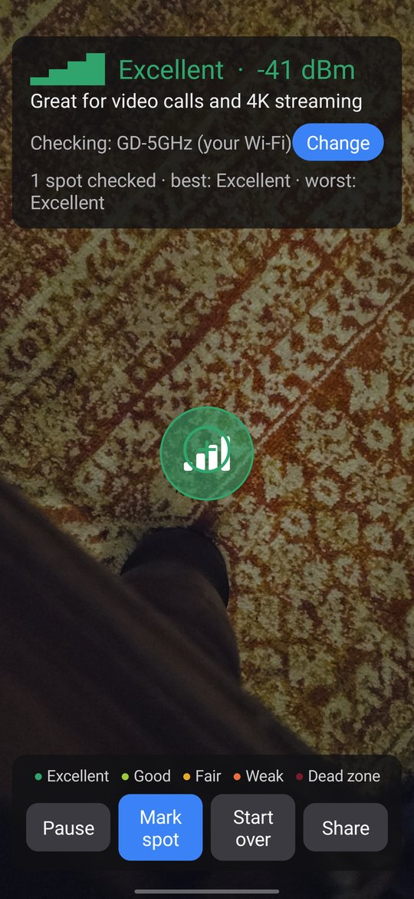

<div align="center">

# 📡 SignalLens

### See your Wi-Fi. Literally.

**Point your phone around a room and watch the Wi-Fi signal appear as glowing bubbles in the air, from green (great) to red (dead zone).**


[](https://github.com/budwhyy/Signalaliens/actions)

<br>



</div>

---

## ✨ What is it?

Ever wondered *why the Wi-Fi is awful in the bedroom*? SignalLens answers it. Walk around slowly with your camera pointed ahead and the app drops a coloured bubble at every spot you pass, showing how strong the Wi-Fi is **right there**. Look back at the room and you can see exactly where the signal is great, patchy, or gone.

No technical knowledge needed. The app talks in plain English: *"Good for streaming and video calls"*, not just numbers.

## 🌈 The colour key

| | Signal | What it means |
|:-:|---|---|
| 🟢 | **Excellent** | Great for video calls and 4K streaming |
| 🟩 | **Good** | Good for streaming and video calls |
| 🟡 | **Fair** | Fine for browsing, video may stutter |
| 🟠 | **Weak** | Slow, and may drop out |
| 🔴 | **Dead zone** | Wi-Fi will barely work here |

## 🚀 Features

- 🫧 **Signal bubbles in AR.** They stay put in the room as you walk away from them.
- 📶 **Any Wi-Fi, not just yours.** Tap **Change** to check any network nearby: a neighbour's, a mesh extender, the café next door.
- 🗣️ **Plain-language readout.** Signal bars, a word like *Excellent*, and what it's good for. The exact **dBm** number sits alongside for the curious.
- ⏸️ **Pause, mark, restart.** Pause the auto-bubbles, add one by hand with **Mark spot**, or **Start over** (it asks first).
- 📤 **Share your results.** One tap sends a readable summary (best spot, worst spot, how many of each) with the full data attached as a spreadsheet.
- 🔒 **Private by design.** Everything stays on your phone. There is no account, no internet access and no tracking.

## 🧭 How to use it

1. **Open SignalLens** and allow **Camera** and **Location**. (Android only lets apps see Wi-Fi names when Location is allowed. The app never records where you are.)
2. **Walk slowly** and keep the camera pointed ahead at something with texture, like a floor or furniture. A blank wall can confuse AR tracking.
3. **Watch the bubbles appear.** Green is good, red is bad.
4. **Want to check another network?** Tap **Change** and pick one.
5. **Tap Share** when you're done.

> 💡 **Tip:** Your own Wi-Fi updates every second or so. Other networks only refresh when Android finishes a scan, which is about every 30 seconds, so stand still at each spot for a moment.
> For faster updates, switch off **Settings → Developer options → Wi-Fi scan throttling**.

## 📱 What you need

- An Android phone (**Android 8.0 or newer**) that supports [Google Play Services for AR](https://developers.google.com/ar/devices)
- A Wi-Fi network to measure 😄

## 📥 Install

**Option 1: download a ready-made APK**
1. Open the [**Actions**](https://github.com/budwhyy/Signalaliens/actions) tab and click the latest green run.
2. Under **Artifacts**, download `SignalLens-debug-…` and unzip it.
3. Send `app-debug.apk` to your phone and open it. Allow "install from this source" if Android asks.

**Option 2: build it yourself**

```bash
git clone https://github.com/budwhyy/Signalaliens.git
cd Signalaliens
./gradlew assembleDebug
```

The APK is created at `app/build/outputs/apk/debug/app-debug.apk`. You need JDK 17 and the Android SDK (platform 35). To install it straight onto a phone with USB debugging on:

```bash
adb install -r app/build/outputs/apk/debug/app-debug.apk
```

## 🛠️ How it works

| Piece | What it does |
|---|---|
| **ARCore** | Tracks the phone's position in the room and pins each bubble to a spot in space |
| **WifiManager** | Reads the signal strength (RSSI) of your network, or scans for others |
| **OpenGL** | Draws the live camera picture |
| **Android Canvas** | Draws the bubbles, signal bars and the centre reticle on top |
| **GitHub Actions** | Builds the debug APK on every push and uploads it as a download |

<details>
<summary>📂 Project layout</summary>

```
app/src/main/java/com/budwhyy/signallens/
├── MainActivity.kt        # AR session, screen, buttons, sharing
├── WifiMonitor.kt         # Reads your Wi-Fi and scans nearby networks
├── SignalScale.kt         # dBm → colour, word, and "what it's good for"
├── OverlayView.kt         # Draws the bubbles and signal bars
└── BackgroundRenderer.kt  # Draws the camera feed
.github/workflows/
└── android-debug.yml      # CI: build + upload the APK
```
</details>

## ⚠️ Good to know

- Wi-Fi signal is affected by walls, doors, people and even your hand over the antenna. Treat the colours as a guide, not a lab measurement.
- This is a **debug build**, signed with a test key, so Play Protect may show an "unknown app" warning.
- Bubbles are capped at 400 at a time. The oldest disappear first.

---

<div align="center">

Made with 💚🟡🔴 for anyone who's ever asked *"why is my Wi-Fi so bad in here?"*

</div>
